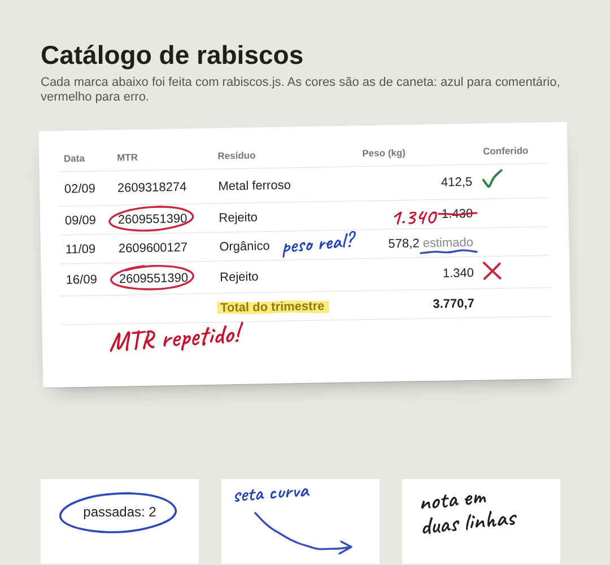

# Rabiscos à mão

Marcas de caneta desenhadas em SVG por cima de qualquer conteúdo HTML: o traço treme devagar como a mão, o círculo começa fora do lugar e passa um pouco do ponto inicial, a seta faz curva e a ponta sai torta, e as notas usam a fonte manuscrita Caveat. Tudo com semente fixa, então o mesmo desenho sai igual toda vez que renderiza.

A skill é só dos rabiscos. O layout do post (fundo, títulos, folhas, cores do resto) é decidido em cada trabalho.



## Arquivos

- `assets/rabiscos.js`: a biblioteca. Expõe `Rabiscos.desenhar(elemento, marcas, opcoes)` e `Rabiscos.desenharTodos()`.
- `assets/rabiscos.css`: a fonte Caveat (arquivos `.woff2` na mesma pasta, licença OFL em `OFL-Caveat.txt`) e o estilo da camada de tinta.
- `scripts/achar_texto.py`: acha a posição de palavras num print com OCR (tesseract), para saber onde circular.
- `scripts/render.py`: transforma o HTML em PNG esperando fonte e rabiscos.
- `exemplos/catalogo.html`: todos os tipos de marca funcionando.

## Como usar

1. Copie a pasta `assets/` para junto do HTML do post e inclua:
   ```html
   <link rel="stylesheet" href="assets/rabiscos.css">
   <script src="assets/rabiscos.js"></script>
   ```
2. Ponha as marcas no elemento que vai receber a tinta. Para rabiscos soltos na página (número da página, desenho na margem, marca-texto no título), use uma camada do tamanho da página: `<div style="position:absolute;inset:0;pointer-events:none" data-rabiscos='[...]'></div>`. Coloque as marcas com `data-rabiscos` (JSON), e chame `Rabiscos.desenharTodos()` no fim da página. O elemento vira `position: relative` se precisar.
   ```html
   <div class="folha" data-rabiscos='[
     {"tipo":"circulo","alvo":{"x":1600,"y":277,"w":110,"h":62},"cor":"vermelho","folga":22,"espessura":4},
     {"tipo":"nota","texto":"qual coleta é essa?","em":[700,-150],"tamanho":52,"rotacao":-3},
     {"tipo":"seta","de":[1420,-120],"para":{"x":1600,"y":277,"w":110,"h":62},"curva":-0.35}
   ]'></div>
   ```
3. Renderize: `python3 scripts/render.py post.html post.png 1080 1350 2` (1080x1350 é o 4:5 do LinkedIn e do Instagram; escala 2 deixa nítido).
4. Olhe o PNG antes de entregar. Nota cortada na borda, nota em cima de texto importante ou seta cruzando conteúdo são os erros mais comuns: mova a nota para o papel vazio e deixe a seta fazer a ligação.

### Onde a marca fica (alvo)

- `{"x","y","w","h"}`: retângulo. Se o elemento tem uma ``, é em **pixels da imagem original**, e a escala é automática. Sem imagem, é em px CSS do elemento.
- `{"seletor":"#id"}`: um elemento. Procura primeiro dentro do container e depois na página toda (assim uma camada solta por cima da página consegue marcar uma palavra do título). Dentro de uma folha girada (`rotate`), usa a posição antes da rotação.
- Qualquer alvo aceita `dx` e `dy` (px CSS) para deslocar: `{"seletor":"#linha10","dy":70}` começa a seta 70 px abaixo da linha.
- `[x, y]`: um ponto, para notas e pontas de seta. Pode ser negativo ou passar da borda, para escrever no papel em volta da folha.

Espessura (`espessura`) e tamanho de letra (`tamanho`) são sempre em px CSS, o que se vê na tela, independente da escala da imagem.

### Tipos de marca

| tipo | campos | quando usar |
|---|---|---|
| `circulo` | `alvo`, `folga` (14) | o achado principal: um número, um erro, um botão |
| `sublinhado` | `alvo`, `amplitude` (2,6) | destacar sem gritar, palavras dentro de texto |
| `seta` | `de`, `para`, `curva` (0,5; negativa curva para o outro lado), `ponta` (true) | ligar a nota ao alvo; sem ponta vira ligação |
| `nota` | `texto` (`\n` quebra linha), `em`, `dx`, `dy`, `tamanho` (42), `rotacao` (-3), `alinhar` | o comentário escrito |
| `visto` | `alvo` | conferido, certo |
| `xis` | `alvo` | errado, descartado |
| `riscado` | `alvo` | valor corrigido; ponha o certo numa `nota` ao lado |
| `marcatexto` | `alvo`, `cor` (amarelo) | fundo de marca-texto atrás de uma palavra ou linha |

Campos de todas: `cor` (`azul`, `vermelho`, `preto`, `verde`, `amarelo` ou `#hex`), `espessura` (3,4), `passadas` (1; com 2 parece caneta passada duas vezes), `semente` (troca o tremor; use outra se dois círculos ficarem iguais demais).

### Achar as coordenadas num print

```bash
python3 scripts/achar_texto.py print.png "0,718" duplicado
# -0,718      {"x": 1600, "y": 277, "w": 110, "h": 26}
```
Cole o `{...}` direto como `alvo`. O OCR às vezes erra acento (Divergência vira "Divergéncia"): busque por um pedaço sem acento. Se a imagem foi recortada, as coordenadas são do arquivo recortado.

## O que faz parecer mão de verdade

O que deu certo nos posts do Pedro (carrossel do sistema de resíduos e DMR):

- **Duas canetas, cada uma com um papel.** Azul (esferográfica, `#2340B5`) para comentário e explicação. Vermelho (`#C4122F`) para erro, problema e o achado principal. Preto e verde só de vez em quando.
- **Poucas marcas.** Duas ou três por imagem. Uma é a principal (círculo vermelho grosso, `espessura` 4) e as outras apoiam. Se tudo está circulado, nada está.
- **Notas curtas, no tom de quem fala.** Minúsculas, como se escreve na margem: "qual coleta é essa?", "veio sozinho", "achou o MTR repetido", "e o peso real?". Nada de frase de efeito ou título.
- **Nota no papel vazio, não em cima do conteúdo.** Escreva na margem ou fora da folha e use uma seta até o alvo. Em cima de texto só se for área vazia da imagem.
- **Tamanho de letra de caneta.** Num post de 1080 px de largura, nota principal entre 48 e 100 px; secundária entre 38 e 52 px. Menor que isso some no celular.
- **Rotação leve e variada.** Notas entre -6° e +3°. Nunca todas com o mesmo ângulo.
- **Imperfeição com controle.** Não aumente o tremor para "parecer mais à mão": o que convence é o círculo que passa do ponto inicial e a ponta de seta torta, não um traço tremido.
- **Folha girada ajuda.** Se o conteúdo é um print, ponha numa "folha" branca com `transform: rotate(-1.2deg)` e sombra curta. As marcas ficam dentro da folha e giram junto, como caneta no papel.

## Erros comuns

- **Fonte não carregou** (nota sai em fonte cursiva padrão): o `rabiscos.css` precisa estar na mesma pasta dos `.woff2`. O `render.py` avisa quando isso acontece.
- **Rabisco no lugar errado numa imagem**: a imagem ainda não tinha carregado. Use `Rabiscos.desenharTodos()`, que espera imagens e fontes.
- **Nota cortada na borda do post**: o post tem `overflow: hidden`. Diminua o `tamanho` ou mova o `em` para a esquerda.
- **Círculos iguais**: duas marcas com a mesma semente e o mesmo tamanho tremem igual. Mude a `semente` de uma delas.
